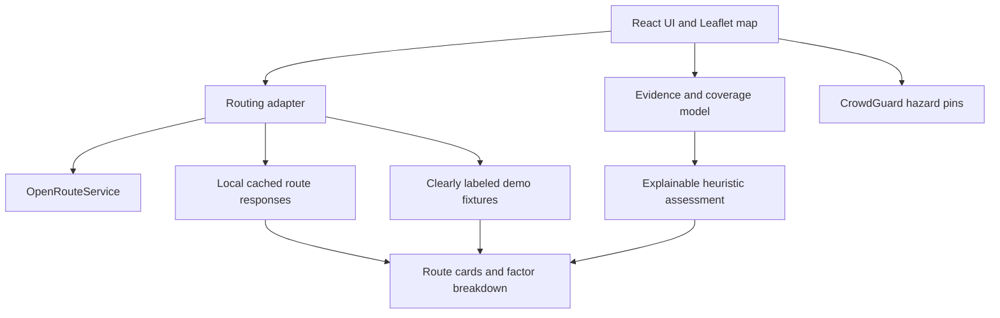

# SafeRoute — Project Guide

## 1. What this prototype does

SafeRoute compares walking-route options with visible evidence coverage and known hazard reports. It is a hackathon decision-support prototype, not a validated prediction or guarantee of personal safety.

**Important data truth:** The included route coordinates, coverage percentages, factor labels, and initial hazard are illustrative demo fixtures. They are not verified measurements of Jaipur streets. The live routing adapter returns route geometry, distance, and estimated duration only; it does not supply lighting or pedestrian activity evidence. The UI attaches fictional simulated indicators solely to demonstrate the assessment workflow. They are visibly labeled and must never be described as real observations.

## 2. Architecture

### Modules

- `src/modules/routing.js`: geocoding and OpenRouteService walking route request. API integration is isolated here.
- `src/modules/cache.js`: stores successful route responses in browser local storage for fallback.
- `src/modules/scoring.js`: normalizes user preference weights, calculates the illustrative demo coverage indicator, flags routes below the demo threshold, and identifies nearby reports.
- `src/modules/demoEvidence.js`: attaches explicitly simulated evidence profiles to live routes for presentation only; values are fictional and are not fetched from OSM.
- `src/modules/demoData.js`: clearly labeled illustrative routes and a seeded demonstration hazard.
- `src/App.jsx`: interface, route selection, map, hazard interaction, and state coordination.
- `src/styles.css`: responsive visual system and Leaflet styling.

## 3. Requirements

- Node.js 20 LTS or newer (Node 20+ recommended)
- npm
- Internet connection for package install, map tiles, geocoding, and live routing
- Optional OpenRouteService API key for live routing

## 5. Demo modes

### Demo mode (no API key required)

The app loads sample route fixtures so you can test the layout, route selection, hazard pins, preference sliders, and evidence warnings. The sample coordinates and metrics are illustrative. Do not present them as verified real-world route safety data.

### Live routing mode

Enter start and destination text, then click **Find walking routes**. The prototype geocodes both strings using Nominatim and requests foot-walking routes from OpenRouteService. The public geocoder has usage policies; avoid repeated rapid requests or autocomplete.

Live route output includes actual geometry and service-reported distance/duration. The app attaches clearly labeled hypothetical indicators for the demo. These are not verified evidence and must not be presented as observations of the selected streets.

### Cached fallback

After a successful live request, the route responses are saved in local storage. If a subsequent live request fails, the app attempts to load those saved responses. A cached route does not guarantee offline map tiles; tiles still come from OpenStreetMap servers. If the network is entirely down, route geometry and cards can still load but the base map may be blank. For a fully offline demo, prepare a screen recording or locally hosted map tiles.

## 7. Known limitations and integration risks

1. **No live safety data adapter yet.** OpenRouteService supplies routes, not the lighting or footfall evidence needed by the product thesis.
2. **Coverage is provisional.** Demo percentages are fixtures and the current demo's overall coverage is a weighted average of factor-level fixture percentages—not true segment-by-segment route-length coverage. The live routing adapter supplies no safety attributes. To make the assessment UI demonstrable, the app attaches simulated coverage profiles. These values are fictional and do not indicate actual lighting, footfall, road conditions, or safety. Before any real-world use, replace the simulation with a verified data source and calculate per-factor coverage by route length.
3. **No production geocoder proxy.** Nominatim is called directly for low-volume demo use; follow its usage policy.
4. **API key exposure.** `VITE_ORS_API_KEY` is visible to browsers. Use a restricted disposable key for the hackathon only; production needs a server-side proxy.
5. **Route alternatives are not guaranteed to be diverse.** The service may return fewer alternatives or overlapping paths.
6. **Hazard matching is a demo approximation.** The included proximity check is not a proper GIS route-segment intersection test. Do not use it for real safety decisions.
7. **No server persistence or moderation.** Added hazard pins exist only in current app state and are not shared with other users.
8. **No automatic rerouting yet.** A hazard pin changes the assessment UI; it does not currently claim to generate a new path.
9. **Time control is a UI preference only.** No live time-dependent pedestrian activity feed is connected.
10. **No validated safety score.** The assessment is a transparent heuristic for demonstration, not a scientific personal-safety prediction.

## 8. Recommended next implementation steps

1. Verify the routing flow and cache fallback.
2. Choose a small Jaipur pilot area and inspect actual OSM attribute coverage before promising the 70% threshold is achievable.
3. Add a real Overpass/OSM evidence adapter only after confirming the needed tags and rate limits.
4. Calculate factor-specific coverage by route length and segment, not by counting tags.
5. Test hazard-aware rerouting only after core routing and cached fallback pass.
6. Record a short backup demo after all critical flows work.
